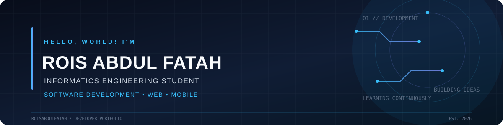

 

 

### ROIS ABDUL FATAH
**Informatics Engineering Student | Aspiring Software Developer**

*Building solutions through code, creativity, and continuous learning.*

 

  

---

## 👨‍💻 About Me

Hello! I'm **Rois Abdul Fatah**, an undergraduate Informatics Engineering student at **Langlangbuana University**.

I'm passionate about exploring technology and developing software solutions, particularly in web and mobile application development.

- 🎓 Studying Informatics Engineering at Langlangbuana University.
- 💻 Exploring software engineering and application development.
- 🌐 Interested in building functional and user-oriented web applications.
- 📱 Exploring mobile development with React Native.
- 🧩 Enjoy solving problems and learning how systems work.
- 🚀 Continuously improving my skills through academic projects and independent learning.

My goal is to turn ideas into practical applications while growing into a well-rounded software developer.

---

## 🛠️ Technical Skills

### Programming Languages

  

### Web Development

  

### Mobile Development

  
  
  
  

### Database & Tools

  
  

---

## 🚀 Featured Projects

Here are some projects I've worked on during my academic journey and personal development.

| Project | Description | Technologies |
|:---|:---|:---|
| **ANDTOP** | Digital top-up platform featuring an internal currency system called TopCoin. | PHP, Laravel, MySQL, CSS |
| **M-Tugas** | Task management system with role-based access, approval workflows, task history, and Excel/PDF exports. | Laravel, MySQL |
| **WebView Application** | Android WebView implementation using different mobile development approaches. | React Native, MIT App Inventor |
| **CATSHOP** | Web-based application for managing cat data and related information. | CodeIgniter 3, PHP, MySQL |
| **To-Do List** | Mobile application for organizing and managing daily activities. | React Native, Expo |
| **TicTacToe** | Interactive two-player Tic-Tac-Toe mobile game. | React Native, JavaScript, Expo |

---

## 🏆 Experience & Activities

**Assistant Moderator**  
*International Conference on ICT for Smart Society (ICISS) 2025*

- Participated as an assistant moderator in an international academic conference.

**PKM-KC Participant**  
*Smart Inclusive-Bin with IoT (SIB-OT) — 2026*

- Participated in a student innovation project focused on developing an inclusive smart waste bin using Internet of Things technology.

---

## 📊 GitHub Statistics

  

---

### 💡 Beyond the Code

*"Great software begins with understanding the problem, not just writing the code."*

**Think. Build. Learn. Improve.**

 

Thanks for visiting my profile! Feel free to explore my repositories.

